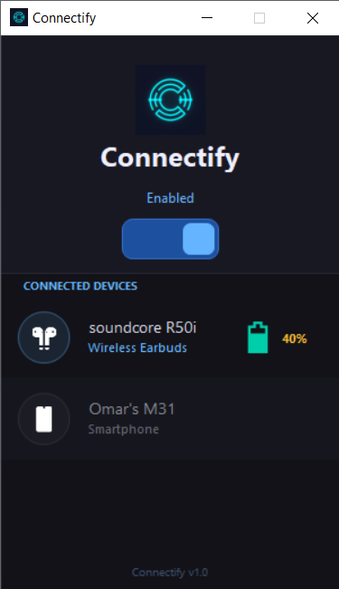

<div align="center">
  <h1>Connectify 🚀</h1>
  <p>A sleek, modern Windows Forms desktop application to manage and monitor Bluetooth devices.</p>

  
  
  
  
  
</div>

<br />

## 📸 Screenshots

 


---

## ✨ Features

- **Toggle Bluetooth State:** Instantly turn your Bluetooth adapter on or off.
- **Device Management:** Discover and view paired and connected Bluetooth devices (Classic and BLE).
- **Battery Monitoring:** Check battery percentage for supported Bluetooth Low Energy (BLE) devices.
- **Dynamic Modern UI:** Built with **Bunifu UI Framework** featuring a stunning dark theme and responsive dynamically generated device cards.
- **Reliable Async Operations:** Prevents UI freezing by performing heavy Bluetooth operations and device discovery safely in the background.

---

## 🛠️ Tech Stack

- **C# 7.3+**
- **.NET Framework 4.7.2**
- **Windows Forms** (WinForms)
- **Bunifu UI Framework** (For modern, sleek UI components)
- **InTheHand.Net.Bluetooth (32feet.NET)** (For Bluetooth Classic operations)
- **InTheHand.BluetoothLE** (For Bluetooth Low Energy operations)
- **Windows Runtime APIs (`Windows.Devices.Bluetooth`)** (For deep Windows OS integration like battery checks and adapter state)

---

## 🏗️ Architecture

Connectify follows strict separation of concerns for a scalable and crash-resistant Windows Forms experience:

- **`Form1.cs` (UI Layer):** Handles layout, event wiring, and renders state to the Bunifu controls. It contains zero direct Bluetooth API calls.
- **`BluetoothManager.cs` (Logic Layer):** The single source of truth for all Bluetooth operations. It wraps all 32feet.NET and WinRT calls, manages background threading, catches hardware exceptions, and safely marshals updates back to the UI.

---

## 🚀 Getting Started

### Prerequisites

- Windows 10 or Windows 11
- Visual Studio 2019 / 2022 (with .NET desktop development workload)
- .NET Framework 4.7.2 SDK

### Installation

1. **Clone the repository:**
   ```bash
   git clone https://github.com/blackjoker94/bluetooth_turnon.git
   cd bluetooth_turnon
   ```

2. **Open the Solution:**
   Double-click `Connectify.sln` to open the project in Visual Studio.

3. **Restore Packages:**
   NuGet packages should restore automatically. If not, right-click the solution in Visual Studio and select **Restore NuGet Packages**.

4. **Build and Run:**
   Press `F5` or click **Start** in Visual Studio to run the application in Debug mode.

---

## ⚠️ Important Notes

- **Threading:** Bluetooth APIs fire events on background threads. Connectify heavily utilizes `SynchronizationContext` and `Control.Invoke` to ensure the UI thread is safely updated without blocking.
- **BLE Battery Services:** Not all Bluetooth LE devices broadcast their battery levels. Devices that do not support this feature will safely display as "N/A" rather than throwing errors.
- **Background Tasks:** Please ensure that all active watchers (like BLE Advertisement watchers) are properly disposed of upon app closing to prevent background memory leaks.

---

## 🤝 Contributing

Contributions, issues, and feature requests are welcome! Feel free to check the [issues page](https://github.com/blackjoker94/bluetooth_turnon/issues).

---

## 📝 License

This project is licensed under the [MIT License](LICENSE).
